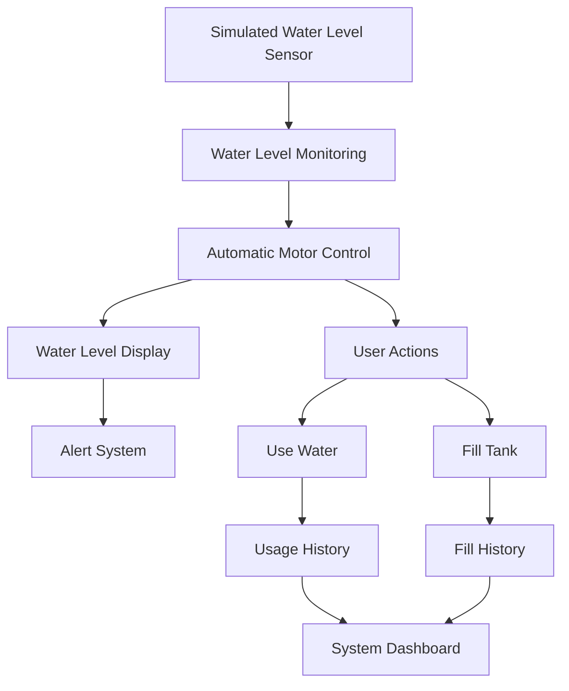

# 💧 Smart Water Tank System

\<p align="center">
&#x20; \
\</p>

\<p align="center">
&#x20; \*\*An intelligent water monitoring and automatic motor control system\*\*
&#x20; \<br/>
&#x20; Monitor water levels, prevent overflow, manage water usage, and receive alerts through a console application or interactive web dashboard.
\</p>

\<p align="center">
&#x20; \
&#x20; \
&#x20; \
&#x20; \
&#x20; \
\</p>

---

## 🚀 Project Overview

The **Smart Water Tank System** is designed to monitor water levels and control a water motor automatically based on predefined water-level thresholds.

It provides two implementations:

1. **Python Console Application** – Simulates sensor readings, controls the motor, manages water usage, and records history.
2. **Web Dashboard** – Displays a visual water tank, motor status, water-level alerts, and interactive controls.

The system also includes overflow protection, water shortage prevention, and timestamped activity records.

## ✨ Key Features

| Feature                    | Description                                       |
| -------------------------- | ------------------------------------------------- |
| 📡 Water Monitoring        | Simulated water-level sensor                      |
| ⚙️ Automatic Motor Control | Motor ON at 30% or below; OFF at 90% or above     |
| 💧 Water Management        | Add or use water through user controls            |
| 🛡️ Overflow Protection    | Prevents water level from exceeding 100%          |
| 🚨 Shortage Protection     | Prevents usage beyond available water             |
| 📊 Usage History           | Records water consumption with timestamps         |
| 📝 Fill History            | Records tank filling activities                   |
| 🔔 Alert System            | Displays different water-level warning conditions |
| 📱 Responsive Dashboard    | Dashboard adapts to desktop and mobile screens    |
| 🔄 Sensor Reset            | Generates a new simulated sensor reading          |

## 🧠 System Architecture



## ⚙️ Automatic Motor Control

The motor operates according to two threshold values:

| Water Level | Motor Status              | Action            |
| ----------- | ------------------------- | ----------------- |
| 0% – 30%    | ON                        | Start filling     |
| 31% – 89%   | Previous state maintained | Normal monitoring |
| 90% – 100%  | OFF                       | Stop filling      |

**Control Logic:**

```python
if level <= LOW:
    motor_on = True
elif level >= HIGH:
    motor_on = False
```

## 🚨 Water-Level Alert System

The system identifies seven water-level conditions:

| Water Level | Alert        |
| ----------- | ------------ |
| 0% – 5%     | 🔴 Critical  |
| 6% – 15%    | 🟠 Very Low  |
| 16% – 30%   | 🟡 Low       |
| 31% – 60%   | 🟢 Normal    |
| 61% – 85%   | 🔵 High      |
| 86% – 99%   | 🟣 Very High |
| 100%        | 🔴 Full      |

## 🖥️ Project Modules

### 1. Water Level Monitoring

Reads the simulated sensor value and displays the current tank level.

### 2. Automatic Motor Control

Controls the motor using LOW and HIGH water-level thresholds.

### 3. Water Usage Management

Allows users to consume water while preventing shortages.

### 4. Tank Filling Management

Allows filling only when the motor is ON and prevents overflow.

### 5. History Management

Maintains separate usage and filling records with timestamps.

### 6. Alert Management

Displays alerts based on the current water level.

### 7. Web Dashboard

Provides a visual tank indicator, live clock, motor status, usage statistics, and interactive controls.

## 🛠️ Technologies Used

| Technology    | Purpose                                 |
| ------------- | --------------------------------------- |
| Python        | Console application and system logic    |
| HTML5         | Dashboard structure                     |
| CSS3          | Styling and responsive layout           |
| JavaScript    | Dashboard interaction and control logic |
| Random Module | Simulated sensor readings               |
| DateTime      | Timestamp management                    |

## 📂 Project Structure

```text
Smart-Water-Tank-System/
│
├── smart_water_tank.py
│
├── index.html
│
└── README.md
```

## ▶️ How to Run the Python Application

**Step 1:** Install Python 3.x.

**Step 2:** Clone the repository.

```bash
git clone https://github.com/rguganrajkumar-coder/smart-water-tank-system.git
```

**Step 3:** Open the project folder.

```bash
cd smart-water-tank-system
```

**Step 4:** Run the application.

```bash
python smart_water_tank.py
```

## 🌐 How to Run the Web Dashboard

1. Open the project folder.
2. Locate `index.html`.
3. Open it in any modern web browser.
4. Use the dashboard controls to monitor water levels, use water, and fill the tank.

> **Note:** The Python console application and web dashboard are separate implementations. Both simulate sensor readings locally; the dashboard is not connected to the Python application or a physical water sensor.

## 🔮 Future Enhancements

- Integration with ESP32 or Arduino.
- Real-time water-level sensor monitoring.
- Physical automatic water pump control.
- IoT-based remote monitoring.
- Cloud-based water usage analytics.
- Mobile application integration.
- Notifications for critical water levels.

## 🎯 Learning Outcomes

- Understanding Python functions and global variables.
- Implementing conditional statements and loops.
- Managing data using lists and tuples.
- Working with timestamps using the DateTime module.
- Developing interactive web dashboards.
- Applying validation and safety checks.
- Understanding automatic control logic.

## 👨‍💻 Developer

**Guganraj R**

B.E. Computer Science and Engineering
K. Ramakrishnan College of Engineering (KRCE)

- GitHub: [@rguganrajkumar-coder](https://github.com/rguganrajkumar-coder)
- Portfolio: [Visit My Portfolio](https://rguganrajkumar-coder.github.io/guganraj-portfolio/)

---

\<p align="center">   \*\*💧 Smart Monitoring | Efficient Water Management | Automated Control\*\*   \<br/>   If you find this project interesting, consider giving it a ⭐ on GitHub! \</p>

\<p align="center">   \ \</p>
