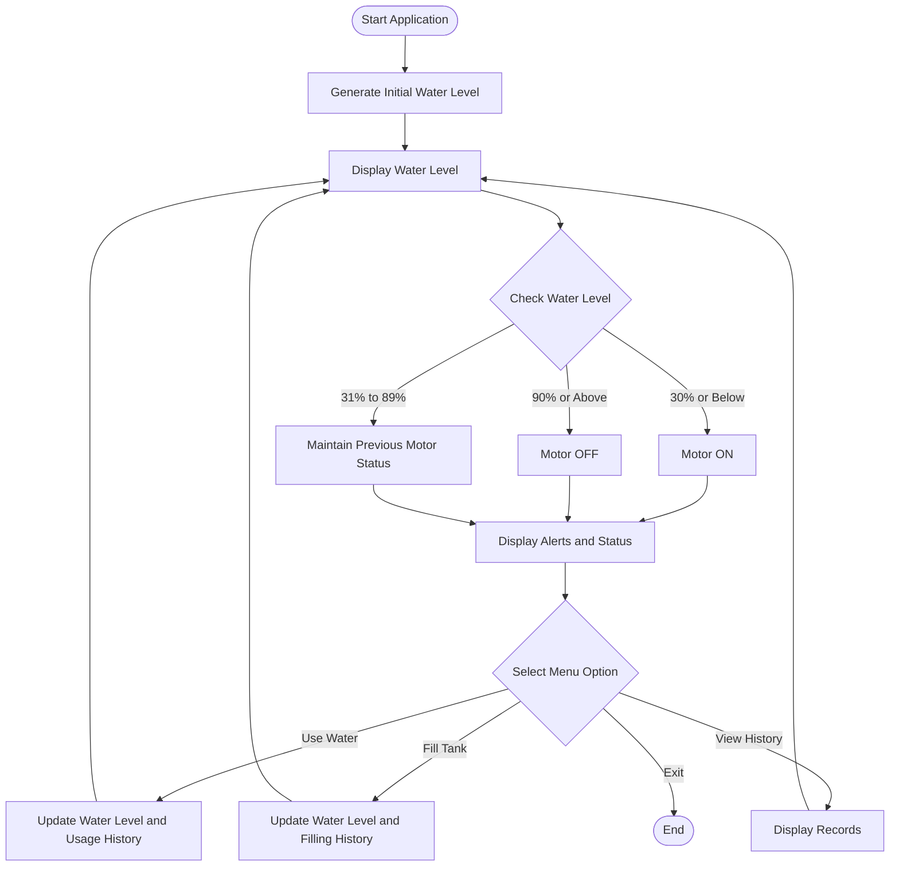

<div align="center">

# 💧 SMART WATER TANK LEVEL MONITORING AND USAGE SYSTEM

### 🌊 Smart Monitoring • Water Management • Intelligent Motor Control

<p>
  
  
  
  
</p>

<p>
  
  
  
</p>

**An intelligent water tank monitoring system designed to monitor water levels, manage water consumption, and control motor operations.**

</div>

---

## 🌟 1. Project Overview

The **Smart Water Tank Level Monitoring and Usage System** is a Python-based application developed to monitor water levels and manage water consumption efficiently.

The project includes:

- 🐍 A Python-based water tank monitoring application.
- 🌐 A separate interactive web dashboard.
- ⚙️ Automatic motor ON/OFF control based on water level.
- 📊 Water usage and filling history.
- 🚨 Multiple water level alert conditions.

The main objective is to encourage efficient water management and reduce unnecessary water wastage.

---

## ✨ 2. Key Features

<table>
<tr>
<td width="50%">

### 💧 Water Monitoring
Monitor the current water level and display the tank status.

### ⚙️ Motor Automation
Automatically control motor status based on water level.

### 📊 Usage Tracking
Track water consumption and maintain usage history.

</td>
<td width="50%">

### 🚨 Smart Alerts
Display alerts according to different water levels.

### 📥 Tank Filling
Manage tank filling when the motor is ON.

### 🌐 Web Dashboard
View simulated water tank information through a browser-based dashboard.

</td>
</tr>
</table>

---

## 📈 3. Water Level Monitoring

The system classifies water levels into different categories.

| Water Level | Status | Indicator |
|:---:|---|:---:|
| 0% – 5% | Critical | 🔴 |
| 6% – 15% | Very Low | 🟠 |
| 16% – 30% | Low | 🟡 |
| 31% – 60% | Normal | 🟢 |
| 61% – 85% | High | 🔵 |
| 86% – 99% | Very High | 🟣 |
| 100% | Tank Full | 💧 |

### ⚙️ Motor Control Logic

| Water Level | Motor Operation |
|---|---|
| 0% – 30% | 🟢 Motor ON |
| 31% – 89% | ⚙️ Maintains Previous Status |
| 90% – 100% | 🔴 Motor OFF |

---

## 🔄 4. System Workflow

The following diagram represents the basic working process of the Python application.



---

## 🖥️ 5. Project Dashboard

The project also contains a separate web-based dashboard.

### 🌐 Web Dashboard

- 📊 Water level visualization.
- ⚙️ Motor status display.
- 🚨 Water level alerts.
- 💧 Water usage information.
- 🎨 Interactive dashboard interface.

**Dashboard File:** `index.html`

> Note: The web dashboard runs independently using its own simulated data. It is not connected to the Python application or physical sensors.

---

## 🛠️ 6. Technologies Used

<div align="center">

| Technology | Purpose |
|---|---|
| 🐍 Python | Main application logic |
| 🌐 HTML5 | Dashboard structure |
| 🎨 CSS3 | Dashboard styling |
| ⚡ JavaScript | Dashboard interactions |
| 🧰 VS Code | Development environment |
| 🐙 Git & GitHub | Version control and hosting |

</div>

---

## 📂 7. Project Structure

```text
SMART-WATER-TANK-SYSTEM/
│
├── 📄 smart_water_tank.py
│      └── Python monitoring application
│
├── 🌐 index.html
│      └── Web monitoring dashboard
│
└── 📘 README.md
       └── Project documentation
```

---

## 🚀 8. Installation and Execution

### Step 1: Clone the Repository

```bash
git clone https://github.com/rguganrajkumar-coder/smart-water-tank-system.git
```

### Step 2: Open the Project Folder

```bash
cd smart-water-tank-system
```

### Step 3: Run the Python Application

```bash
python smart_water_tank.py
```

### Step 4: Open the Web Dashboard

Open `index.html` in any modern web browser.

---

## 🎮 9. Application Menu

The Python application provides the following interactive options:

```text
========================================
       SMART WATER TANK SYSTEM
========================================

1. Use Water
2. Fill Tank
3. View Usage History
4. View Fill History
5. Exit

========================================
```

---

## 🔮 10. Future Enhancements

The following features can be added in future versions:

- 📡 ESP32 / Arduino hardware integration.
- 📏 Ultrasonic water level sensor.
- 📱 Mobile application integration.
- ☁️ Cloud-based data storage.
- 🔔 Real-time notifications.
- 📈 Advanced water consumption analytics.
- 🌍 IoT-based remote monitoring.

---

## 👨‍💻 11. Developer Information

<div align="center">

### GUGANRAJ R

**B.E. Computer Science and Engineering**

K. Ramakrishnan College of Engineering (KRCE)  
Tiruchirappalli, Tamil Nadu, India.

<p>
  <a href="https://github.com/rguganrajkumar-coder">
    
  </a>
  <a href="https://rguganrajkumar-coder.github.io/guganraj-portfolio/">
    
  </a>
</p>

</div>

---

<div align="center">

## 💧 SMART WATER MANAGEMENT FOR A BETTER TOMORROW

### 🌱 Monitor Water • Control Usage • Save Resources

**Developed with 💙 by Guganraj R**

</div>
