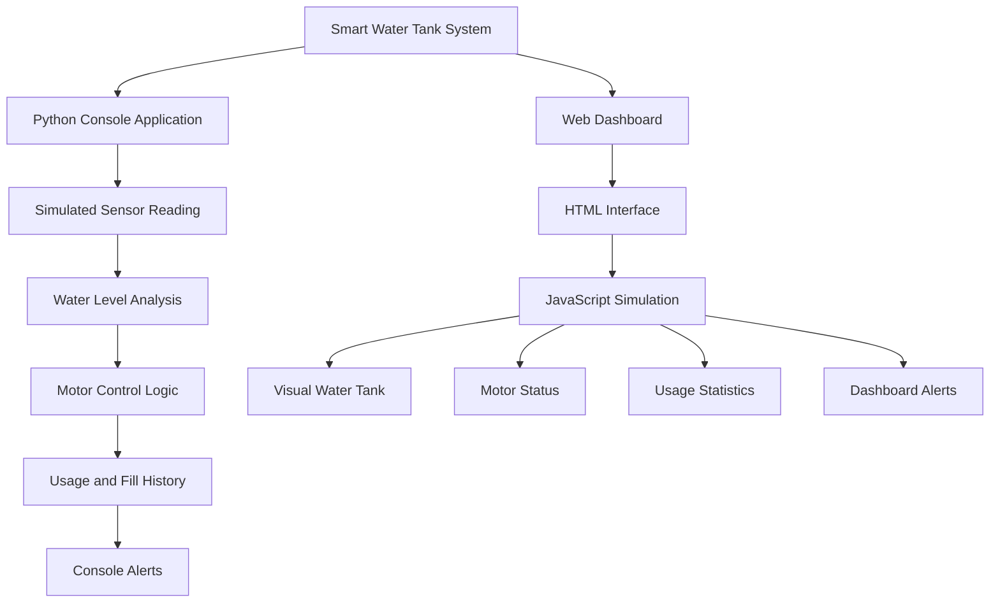

# 💧 Smart Water Tank System

\<p align="center">
&#x20; \
\</p>

\<p align="center">
&#x20; \<strong>An Intelligent Water Monitoring and Automatic Motor Control System\</strong>
&#x20; \<br>
&#x20; Monitor water levels, prevent overflow, manage water usage, and receive alerts through a Python console application or an interactive web dashboard.
\</p>

\<p align="center">
&#x20; \
&#x20; \
&#x20; \
&#x20; \
&#x20; \
\</p>

---

## 📌 Project Overview

The **Smart Water Tank System** is designed to monitor water levels, manage water consumption, and control motor operations automatically based on the tank's water level.

The project contains two independent implementations:

1. **Python Console Application** – Simulates water-level monitoring, motor control, water usage, tank filling, and alert management.
2. **Web Dashboard** – Provides a responsive visual interface with a simulated water tank, motor status, water usage statistics, alerts, and interactive controls.

Both implementations demonstrate the concept of smart water management. They operate independently and do not share live data.

## ✨ Key Features

- 💧 Water Level Monitoring
- ⚙️ Automatic Motor ON/OFF Simulation
- 🚨 Low-Level and Overflow Alerts
- 📊 Water Usage Tracking
- 🔄 Tank Filling and Water Consumption
- 🕒 Timestamped Activity History
- 🌐 Interactive Web Dashboard
- 📱 Responsive User Interface
- 🛡️ Water Shortage and Overflow Prevention

---

## 🏗️ System Architecture

The project has two independent execution paths.



## ⚙️ Motor Control Logic

The system uses water-level thresholds to simulate automatic motor operation.

| Water Level | Motor Status   | Description                              |
| ----------- | -------------- | ---------------------------------------- |
| 0% – 30%    | ON             | Low water level; motor starts            |
| 31% – 89%   | Previous State | Maintains the previous motor state       |
| 90% – 100%  | OFF            | Tank is sufficiently filled; motor stops |

**Control Logic:**

- When the water level reaches 30% or below, the motor turns ON.
- When the water level reaches 90% or above, the motor turns OFF.
- Between 31% and 89%, the previous motor state is maintained.

This approach avoids unnecessary frequent switching of the motor.

## 🚨 Alert System

The application provides alerts based on the current water level.

| Water Level | Alert    | Meaning                                   |
| ----------- | -------- | ----------------------------------------- |
| 0% – 20%    | Critical | Very low water level                      |
| 21% – 30%   | Low      | Water level is low                        |
| 31% – 89%   | Normal   | Water level is within the operating range |
| 90% – 100%  | High     | Tank is nearly full or full               |

## 🐍 Python Console Application

The Python implementation simulates a smart water tank monitoring system through a console interface.

### Features

- Generates simulated sensor readings between 20% and 80%.
- Automatically controls the motor using threshold-based logic.
- Supports water consumption and tank filling.
- Prevents water shortage during consumption.
- Prevents tank overflow during filling.
- Maintains water usage and filling history.
- Displays timestamped activity records.
- Calculates total water consumption.
- Provides water-level alerts.

### Run the Python Application

**Step 1:** Install Python 3.x.

**Step 2:** Clone the repository.

```bash
git clone https://github.com/rguganrajkumar-coder/smart-water-tank-system.git
```

**Step 3:** Open the project folder.

```bash
cd smart-water-tank-system
```

**Step 4:** Run the Python file.

```bash
python smart_water_tank.py
```

No additional Python packages are required if the program uses only Python's built-in modules.

---

## 🌐 Web Dashboard

The web implementation provides an interactive dashboard for visualizing simulated water tank operations.

### Dashboard Features

- Visual water tank representation.
- Simulated water-level readings.
- Motor ON/OFF status indicator.
- Water consumption statistics.
- Tank filling controls.
- Water usage controls.
- Real-time alert display.
- Activity history.
- Reset functionality with a new simulated reading.
- Responsive layout for different screen sizes.

### Run the Web Dashboard

1. Open the cloned project folder.
2. Locate `index.html`.
3. Double-click the file to open it in your browser.
4. Use the dashboard controls to simulate water usage and tank filling.

No backend server or paid service is required for the standalone dashboard.

---

## 🛠️ Technologies Used

| Technology   | Purpose                                        |
| ------------ | ---------------------------------------------- |
| Python       | Console application and water management logic |
| HTML5        | Dashboard structure                            |
| CSS3         | Dashboard styling and responsive design        |
| JavaScript   | Interactive dashboard and simulation           |
| Mermaid      | System architecture diagram                    |
| Git & GitHub | Version control and project hosting            |

## 📂 Project Structure

```text
smart-water-tank-system/
│
├── smart_water_tank.py
│
├── index.html
│
└── README.md
```

| File                  | Description                        |
| --------------------- | ---------------------------------- |
| `smart_water_tank.py` | Python-based water tank simulation |
| `index.html`          | Interactive web dashboard          |
| `README.md`           | Project documentation              |

## 🔮 Future Enhancements

- ESP32-based real-time water-level monitoring.
- Integration with ultrasonic water-level sensors.
- Physical water pump and relay control.
- Mobile notifications for critical alerts.
- Cloud-based monitoring and data storage.
- Historical water consumption analytics.
- IoT-based remote monitoring.

## 🎯 Learning Outcomes

Through this project, I explored:

- Python programming and conditional logic.
- Simulation of sensor-based systems.
- Automatic motor control concepts.
- Water usage and resource management.
- HTML, CSS, and JavaScript development.
- Interactive dashboard design.
- GitHub project documentation.

---

## 👨‍💻 Developer

\<p align="center">
&#x20; \<strong>Guganraj R\</strong>
&#x20; \<br>
&#x20; B.E. Computer Science and Engineering
&#x20; \<br>
&#x20; K. Ramakrishnan College of Engineering (KRCE)
&#x20; \<br>
&#x20; Tiruchirappalli, Tamil Nadu, India
\</p>

\<p align="center">
&#x20; \<a href="[https://github.com/rguganrajkumar-coder](https://github.com/rguganrajkumar-coder)">
&#x20;   \
&#x20; \</a>
&#x20; \<a href="[https://rguganrajkumar-coder.github.io/guganraj-portfolio/](https://rguganrajkumar-coder.github.io/guganraj-portfolio/)">
&#x20;   \
&#x20; \</a>
\</p>

---

\<p align="center">   \<strong>💧 Smart Water Management for a Sustainable Future!\</strong>   \<br>   Built with Python, HTML, CSS and JavaScript. \</p>
